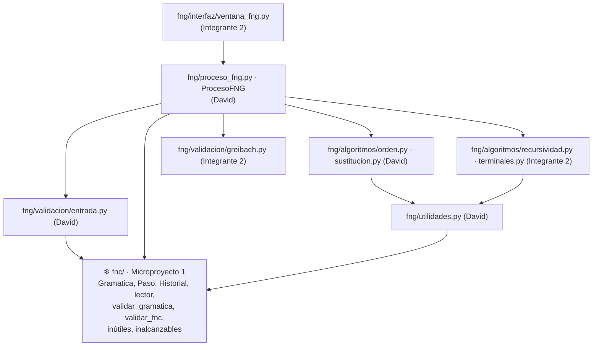

# Guía de trabajo del equipo: Microproyecto 2, de FNC a Forma Normal de Greibach

> **Documento interno y temporal.** Esta guía vive solo en esta rama. **No se fusiona con `main`** y **no se abre Pull Request desde esta rama.** Al terminar se borra la rama (sección 16) y la guía desaparece del repositorio.

| | |
|---|---|
| **Integrante 1** | David Santiago Rincón Bautista |
| **Integrante 2** | __________________________ (escribir nombre) |
| **Materia** | Teoría de la Computación, Microproyecto #2 (2026/02) |
| **Entrega** | ______________ en NPLAD (**confirmar con la profesora**: el enunciado dice 30 de septiembre, que era la fecha del Microproyecto 1). Después, sustentación |
| **Enunciado** | `MICROPROYECTO1-FNG.pdf` (lo compartió David) |

**Índice:**
1. Resumen
2. Decisiones técnicas
3. Preparar el entorno
4. Estructura del proyecto y zona congelada
5. Contrato compartido (firmas que ambos respetan)
6. División del trabajo en detalle
7. Especificación del algoritmo
8. Gramáticas de prueba y resultados esperados
9. Matriz de trazabilidad
10. Documento técnico y manual de usuario
11. Cronograma
12. Git y reglas de no interferencia
13. Ejecutable y paquete de entrega
14. Preparación de la sustentación
15. Checklist final
16. Al terminar: borrar esta guía

---

## 1. Resumen

**Qué construimos:** un aplicativo de escritorio que recibe una gramática **en Forma Normal de Chomsky** y la convierte, mostrando cada paso, en una gramática equivalente en **Forma Normal de Greibach**, donde toda producción es `A → a A1 A2 … An`.

**Base:** el Microproyecto 1 ya tiene resuelto todo lo que no es el algoritmo nuevo:
- el modelo de gramática y el historial de pasos;
- la lectura de la entrada y la validación (incluida la validación de FNC);
- la eliminación de variables inútiles e inalcanzables;
- el diseño de la ventana.

Este proyecto **reutiliza** ese código sin modificarlo y agrega solo lo nuevo, en la carpeta `fng/`.

**División en una tabla:**

| | David | Integrante 2 |
|---|---|---|
| **Código** | Utilidades comunes, validación de la entrada, ordenamiento de variables, **sustituciones hacia adelante (fase 1)**, controlador `ProcesoFNG`, ejemplos, prueba de integración, README | **Recursividad izquierda** (detectar, eliminar, variables auxiliares), **sustitución regresiva y conversión de auxiliares (fases 2 y 3)**, verificación y **validación final de FNG**, **interfaz**, ejecutable |
| **Documento técnico** | Portada → objetivos, marco teórico (parte A), requerimientos, algoritmo (validación, ordenamiento, sustituciones), implementación, pruebas G1, G4, G6 y G8, resultados, conclusiones, referencias, **ensamblar** | Marco teórico (parte B), **5 diagramas**, algoritmo (recursividad, nuevas variables, conversión a terminal, validación FNG), pruebas G2, G3, G5 y G7 |
| **Manual de usuario** | Validación de FNC, historial, interpretación de la gramática final, mensajes de error | Presentación, requisitos, instalación, ingreso, conversión paso a paso y automática, **ensamblar** |
| **Carga estimada** | ≈ 22 h | ≈ 22 h |

**Regla principal:**
- Cada archivo tiene **un solo dueño** (sección 4).
- Los dos trabajos solo se conectan en las firmas de la sección 5.
- El código del Microproyecto 1 está **congelado**: nadie lo modifica.

---

## 2. Decisiones técnicas

| Decisión | Por qué |
|---|---|
| **Python 3.11+ con Tkinter**, igual que el Microproyecto 1 | El enunciado lo permite, ya lo dominamos y podemos reutilizar el código |
| **Mismo repositorio**, carpeta nueva `fng/` | `fng/` importa directamente `fnc.modelo`, `fnc.entrada`, `fnc.validacion` y `fnc.algoritmos`, sin copiar código. El Microproyecto 2 continúa el trabajo del 1 |
| **Aplicación y ejecutable separados** (`main_fng.py` → `ConversorFNG.exe`) | Es otro entregable. El Microproyecto 1 sigue funcionando igual (`main.py`) |
| **Mismo criterio de validación que pidió la profesora en el Microproyecto 1** | Solo bloquea lo **mal escrito**. Los símbolos no declarados se descartan con advertencia y el proceso sigue. Además, **una producción que no está en FNC sí bloquea** la conversión (el algoritmo la necesita), pero el aplicativo ofrece convertirla primero con el Microproyecto 1 (sección 7.13) |
| **Algoritmo clásico de Hopcroft y Ullman**: ordenar → sustituir hacia adelante → eliminar recursividad izquierda → sustituir hacia atrás → convertir auxiliares | Es el que se ve en clase, y coincide con el ejemplo del libro (gramática G1 de la sección 8) |
| **Variables auxiliares con apóstrofo** (`B'`, `S'`; `B''` si `B'` ya existe) | Así se distinguen de las `X1, X2…` del Microproyecto 1 y se ve de qué variable salen. Es la notación habitual en clase (A → βA′) |

---

## 3. Preparar el entorno (ambos, 10 minutos)

Ya tienen Python, Git y el repositorio del Microproyecto 1. Solo hay que actualizar:

```bash
git checkout main
git pull origin main
py -m unittest discover -s pruebas -v
```

La última línea debe terminar en `OK`, con las 70 pruebas del Microproyecto 1. **Si no da OK, no empiecen**: avisen primero.

Cada uno verifica su identidad de Git, para que los commits salgan a su nombre:
```bash
git config user.name
git config user.email
```

---

## 4. Estructura del proyecto y zona congelada

```
Microproyecto_FNC/
├── main.py                         ❄ Microproyecto 1 (no tocar)
├── construir_exe.bat               ❄ Microproyecto 1 (no tocar)
├── ejemplos/                       ❄ Microproyecto 1 (no tocar)
├── fnc/                            ❄ Microproyecto 1 (no tocar: solo se IMPORTA)
├── README.md                       David          (agregar sección "Microproyecto 2")
├── main_fng.py                     Integrante 2   Punto de entrada del Microproyecto 2
├── construir_exe_fng.bat           Integrante 2   Genera dist/ConversorFNG.exe
├── ejemplos_fng/                   David          G1…G7 (.txt), sección 8
├── fng/
│   ├── __init__.py                 David
│   ├── utilidades.py               David          reemplazar_cabeza, calcular_cambios, crear_paso
│   ├── validacion/
│   │   ├── __init__.py             David
│   │   ├── entrada.py              David          validar_entrada (escritura + símbolos + FNC)
│   │   └── greibach.py             Integrante 2   validar_fng
│   ├── algoritmos/
│   │   ├── __init__.py             David
│   │   ├── orden.py                David          ordenamiento de variables y ε del inicial
│   │   ├── sustitucion.py          David          fase 1: sustituciones hacia adelante
│   │   ├── recursividad.py         Integrante 2   fase 1: recursividad izquierda y auxiliares
│   │   └── terminales.py           Integrante 2   fases 2 y 3 + verificación
│   ├── proceso_fng.py              David          controlador ProcesoFNG
│   └── interfaz/
│       ├── __init__.py             Integrante 2
│       └── ventana_fng.py          Integrante 2
└── pruebas/
    ├── (pruebas del Microproyecto 1)    ❄ no tocar
    ├── utilidades_pruebas_fng.py        David   comparación de lenguajes (CYK vs. FNG)
    ├── test_fng_entrada.py              David
    ├── test_fng_orden_sustitucion.py    David
    ├── test_fng_proceso.py              David
    ├── test_fng_ejemplos.py             David   integración G1…G8 + equivalencia
    ├── test_fng_recursividad.py         Integrante 2
    ├── test_fng_terminales.py           Integrante 2
    └── test_fng_validacion_fng.py       Integrante 2
```

**❄ Zona congelada:** `fnc/`, `main.py`, `ejemplos/`, `construir_exe.bat` y las pruebas del Microproyecto 1. Ya se entregaron y funcionan.
- Si alguien encuentra un error ahí, **no lo arregla**: le avisa a David. David lo corrige en un commit aparte y corre **todas** las pruebas.
- Si `fng/` necesita algo distinto de lo que hace `fnc/`, se escribe en `fng/`. Nunca se modifica `fnc/`.

**Arquitectura** (las flechas son «importa a»):



**Comandos:**

| Acción | Comando |
|---|---|
| Ejecutar el Microproyecto 2 | `py main_fng.py` |
| Ejecutar el Microproyecto 1 (debe seguir funcionando) | `py main.py` |
| Todas las pruebas (las de los dos proyectos) | `py -m unittest discover -s pruebas -v` |

---

## 5. Contrato compartido

> Nadie cambia una firma de esta sección sin avisar al otro. Lo interno de cada función lo decide su dueño.

### 5.1 Entrada

Es el mismo formato del Microproyecto 1: campos de variables, terminales y símbolo inicial, producciones con `->` o `→`, alternativas con `|`, ε como `ε`, `λ` o `eps`, y los mismos archivos `.txt`.

Lo nuevo es un campo **opcional**, «Orden de las variables»: una lista separada por comas, por ejemplo `S, A, B`. Si queda vacío, se usa el orden por defecto (sección 7.3).

### 5.2 Lo que se reutiliza del Microproyecto 1 (solo lectura)

```python
from fnc.modelo.gramatica import Gramatica, Cuerpo, Produccion       # modelo y orden canónico
from fnc.modelo.historial import Paso, Historial                      # pasos e historial
from fnc.entrada.lector import leer_archivo, guardar_archivo, leer_simbolos
from fnc.validacion.validador import validar_gramatica, validar_fnc  # validación indulgente + FNC
from fnc.algoritmos.inutiles import eliminar_variables_inutiles       # depuración previa
from fnc.algoritmos.inalcanzables import eliminar_variables_inalcanzables  # depuración y limpieza
from fnc.proceso import ProcesoFNC                                    # opcional, sección 7.13
```

Recuerden lo que ya hacen estas piezas:
- `Gramatica.cuerpos_de()` devuelve los cuerpos en orden canónico.
- `agregar_produccion` evita duplicados (RNF07).
- `Paso.a_texto()` ya produce el formato del historial.

### 5.3 `fng/utilidades.py` (dueño: David; es lo primero que se sube)

```python
def reemplazar_cabeza(cuerpo: Cuerpo, reemplazos: list[Cuerpo]) -> list[Cuerpo]:
    """Cambia el PRIMER símbolo de `cuerpo` por cada cuerpo de `reemplazos`.
    reemplazar_cabeza(("S", "A"), [("A", "B"), ("b",)]) -> [("A", "B", "A"), ("b", "A")]"""

def calcular_cambios(antes: Gramatica, despues: Gramatica) -> tuple[list[Produccion], list[Produccion]]:
    """(eliminadas, agregadas) = producciones de `antes` que no están en `despues` y viceversa,
    cada lista en el orden canónico de su gramática. Es el CAMBIO NETO del paso."""

def crear_paso(nombre: str, antes: Gramatica, despues: Gramatica,
               elementos: dict[str, list[str]], observaciones: list[str] | None = None) -> Paso:
    """Arma un Paso con eliminadas/agregadas calculadas por calcular_cambios.
    TODOS los pasos nuevos del Microproyecto 2 se crean con esta función."""

def aplicar_sustitucion(gramatica: Gramatica, variable: str, cuerpo: Cuerpo) -> str:
    """MODIFICA `gramatica` (úsenla sobre la copia de trabajo): quita `variable -> cuerpo` y agrega
    los cuerpos con la primera variable reemplazada por todas sus producciones.
    Devuelve el texto para "Sustituciones realizadas", p. ej. "B -> S A  ⇒  B -> A B A".
    Es LA operación de sustitución de las fases 1, 2 y 3: así el historial sale igual en todas."""

def texto_sustitucion(variable: str, cuerpo: Cuerpo, nuevos: list[Cuerpo]) -> str: ...  # formato de 5.5
def empieza_con_variable(gramatica: Gramatica, cuerpo: Cuerpo) -> bool: ...              # cuerpo ≠ ε y 1.º símbolo variable
```

> **Ya está en `main`**, con sus pruebas en `pruebas/test_fng_utilidades.py`. Los 7 ejemplos también están en `ejemplos_fng/`.

### 5.4 Funciones de los algoritmos

Todas reciben una `Gramatica`, **no la modifican** (trabajan sobre `copiar()`) y devuelven un `Paso` cuya `gramatica_resultante` es la gramática nueva.

```python
# fng/validacion/entrada.py                     (David)
@dataclass
class ResultadoEntrada:
    gramatica: Gramatica | None          # gramática lista para convertir (None si hay errores)
    errores: list[str]                   # BLOQUEAN: escritura o producciones fuera de la FNC
    errores_fnc: list[str]               # los errores que son "no está en FNC" (para ofrecer el Microproyecto 1)
    advertencias: list[str]              # símbolos no declarados, etc.
    gramatica_ingresada: Gramatica | None
    producciones_descartadas: list[Produccion]
def validar_entrada(texto_variables: str, texto_terminales: str,
                    texto_inicial: str, texto_producciones: str) -> ResultadoEntrada: ...

# fng/algoritmos/orden.py                       (David)
def calcular_orden(gramatica: Gramatica, orden_usuario: list[str] | None = None) -> tuple[list[str], list[str]]: ...
    # (orden, advertencias)
def ordenar_variables(gramatica: Gramatica, orden_usuario: list[str] | None = None) -> tuple[Paso, list[str]]: ...
    # (paso "Ordenamiento de variables", orden). Si el inicial tiene ε, la aparta (sección 7.3)

# fng/algoritmos/sustitucion.py                 (David)
def sustituir_hacia_adelante(gramatica: Gramatica, orden: list[str], indice: int) -> Paso: ...
    # Fase 1 para A_(indice+1) = orden[indice]

# fng/algoritmos/recursividad.py                (Integrante 2)
def detectar_recursividad_izquierda(gramatica: Gramatica, variable: str) -> list[Produccion]: ...
def nombre_variable_auxiliar(gramatica: Gramatica, variable: str) -> str: ...      # "B" -> "B'" (o "B''")
def eliminar_recursividad_izquierda(gramatica: Gramatica, variable: str, posicion: int) -> Paso: ...
    # posicion = i (1, 2, …) solo para el nombre del paso

# fng/algoritmos/terminales.py                  (Integrante 2)
def sustitucion_regresiva(gramatica: Gramatica, orden: list[str]) -> Paso: ...                 # fase 2
def convertir_variables_auxiliares(gramatica: Gramatica, auxiliares: list[str]) -> Paso: ...    # fase 3
def verificar_variables_tras_terminal(gramatica: Gramatica) -> Paso: ...

# fng/validacion/greibach.py                    (Integrante 2)
def validar_fng(gramatica: Gramatica) -> list[str]: ...    # [] = cumple la FNG
```

### 5.5 Nombres exactos de los pasos (en este orden)

| # | Nombre del paso | Quién lo crea | Claves de `elementos_identificados` |
|---|---|---|---|
| 1 | `Validación de la gramática` | David (controlador) | Igual que en el Microproyecto 1 |
| 2 | `Validación de la Forma Normal de Chomsky` | David (controlador) | `"Resultado"` |
| 3 | `Depuración previa: eliminación de variables inútiles` | David (reutiliza el del Microproyecto 1 y le cambia el nombre) | Los del Microproyecto 1 |
| 4 | `Depuración previa: eliminación de variables inalcanzables` | David (ídem) | Los del Microproyecto 1 |
| 5 | `Ordenamiento de variables` | David | `"Orden de las variables"`: `["A1 = S", "A2 = A", …]` |
| 6… | `Fase 1 · A{i} = {X}: sustituciones` (uno por variable) | David | `"Producciones analizadas"`, `"Sustituciones realizadas"` |
| (si aplica) | `Fase 1 · A{i} = {X}: eliminación de recursividad izquierda` | Integrante 2 | `"Producciones con recursividad izquierda"`, `"Producciones sin recursividad (β)"`, `"Variable auxiliar creada"` |
| | `Fase 2: sustitución regresiva` | Integrante 2 | `"Sustituciones realizadas"` |
| | `Fase 3: conversión de variables auxiliares` | Integrante 2 | `"Variables auxiliares"`, `"Sustituciones realizadas"` |
| | `Verificación: solo variables después del terminal` | Integrante 2 | `"Producciones revisadas"` |
| | `Limpieza final` | David | Los de inalcanzables del Microproyecto 1 |
| | `Validación de la Forma Normal de Greibach` | David (llama a `validar_fng`) | `"Resultado"` o `"Producciones que no cumplen la FNG"` |

**Formato de cada sustitución** (en `"Sustituciones realizadas"`): `B -> S A  ⇒  B -> A B A`, que es la producción original, `  ⇒  ` y los cuerpos nuevos separados por ` | `.

### 5.6 Controlador `fng/proceso_fng.py` (dueño: David, lo usa el Integrante 2)

```python
class ErrorProcesoFNG(Exception):
    """Error con mensaje listo para el usuario."""

class ProcesoFNG:
    def ingresar_gramatica(self, texto_variables: str, texto_terminales: str, texto_inicial: str,
                           texto_producciones: str, texto_orden: str = "") -> None: ...
    def validar(self) -> list[str]: ...              # errores que BLOQUEAN ([] = puede convertir)
    def gramatica_es_valida(self) -> bool: ...
    def errores_son_de_fnc(self) -> bool: ...        # True si lo único que falla es "no está en FNC"
    def hay_siguiente_paso(self) -> bool: ...
    def siguiente_paso(self) -> Paso: ...            # MODO PASO A PASO: calcula y registra UN paso
    def ejecutar_todo(self) -> list[Paso]: ...       # MODO AUTOMÁTICO: todos los pasos que falten
    def proceso_terminado(self) -> bool: ...
    def lenguaje_vacio(self) -> bool: ...
    def orden_variables(self) -> list[str]: ...      # [] hasta que se ejecute el paso de ordenamiento
    def gramatica_original(self) -> Gramatica | None: ...
    def gramatica_actual(self) -> Gramatica | None: ...
    def gramatica_final(self) -> Gramatica | None: ...   # None hasta terminar
    def historial(self) -> Historial: ...
    def reiniciar(self) -> None: ...
    def convertir_entrada_con_microproyecto1(self) -> dict[str, str]: ...   # sección 7.13
```

### 5.7 Reglas de oro

1. **No se modifica `fnc/`** ni nada marcado con ❄.
2. Los algoritmos **no modifican** la gramática que reciben.
3. **Orden canónico siempre:** recorrer con `cuerpos_de()`, `variables_en_orden()` o el `orden` calculado; **nunca** un `set` sin ordenar (RNF10, resultado reproducible).
4. Los pasos se crean **solo** con `crear_paso`, así eliminadas y agregadas son el **cambio neto** del paso.
5. Las producciones se agregan **solo** con `agregar_produccion` (RNF07, sin duplicados).
6. Docstring en cada función pública y comentarios en los pasos principales (RNF04).
7. Nombres en español y descriptivos (RNF05).
8. **Nada copiado** de otros equipos ni de internet: el enunciado anula los proyectos semejantes.

---

## 6. División del trabajo en detalle

### 6.1 David: entrada, ordenamiento, fase 1 (sustituciones) y controlador

**Código (≈ 11 h)**

| # | Tarea | Archivo | Requisitos | Horas | Listo cuando... |
|---|---|---|---|---|---|
| D1 | Estructura `fng/`, `utilidades.py` y los 7 archivos de ejemplo (G1–G7) | `fng/…`, `ejemplos_fng/` | RNF04 | 1 | Está en `main` el **día 1**. El Integrante 2 puede importar `reemplazar_cabeza` y `crear_paso` |
| D2 | Validación de la entrada | `fng/validacion/entrada.py` | RF01–RF06, RNF11 | 1 | G6 da los errores de la sección 8 y los símbolos no declarados se descartan como en el Microproyecto 1 |
| D3 | Ordenamiento (por defecto y personalizado) y ε del inicial | `fng/algoritmos/orden.py` | RF07 | 1 | G1 da `A1 = S, A2 = A, A3 = B`, G8 da `B, A, S` y G4 aparta `S0 -> ε` |
| D4 | Sustituciones hacia adelante (sucesivas) | `fng/algoritmos/sustitucion.py` | RF08, RF09, RNF06 | 2 | El paso de A3 en G1 es exactamente el de la sección 8 |
| D5 | Controlador `ProcesoFNG`: pasos uno a uno, modos, depuración previa, limpieza final, validación FNG, lenguaje vacío y reinicio | `fng/proceso_fng.py` | RF15–RF21, RNF09, RNF12 | 3 | G1–G8 dan el mismo número de pasos y la misma gramática final que la sección 8 |
| D6 | Backend de «convertir primero con el Microproyecto 1» | `fng/proceso_fng.py` | RNF02 | 0,5 | G6 se convierte y luego pasa la validación |
| D7 | Pruebas propias e **integración con equivalencia** (G1–G8: todas las cadenas hasta longitud n coinciden) | `pruebas/test_fng_*.py` (suyos) | RNF06, RNF10 | 2 | Todo en verde, también las del Microproyecto 1 |
| D8 | Sección «Microproyecto 2» del README | `README.md` | | 0,5 | Explica cómo ejecutar los dos proyectos |

### 6.2 Integrante 2: recursividad, fases 2 y 3, validación FNG, interfaz y ejecutable

**Código (≈ 11,5 h)**

| # | Tarea | Archivo | Requisitos | Horas | Listo cuando... |
|---|---|---|---|---|---|
| C1 | Detectar y eliminar la recursividad izquierda; nombres de auxiliares | `fng/algoritmos/recursividad.py` | RF10–RF12, RNF08 | 2 | G3 crea `S'` y G1 crea `B'` exactamente como en la sección 8. Si `B'` ya existe, usa `B''` |
| C2 | Sustitución regresiva, conversión de auxiliares y verificación tras terminal | `fng/algoritmos/terminales.py` | RF13, RF14 | 2,5 | Los pasos de las fases 2 y 3 de G1 y G5 coinciden con la sección 8 |
| C3 | `validar_fng` | `fng/validacion/greibach.py` | RF17, RNF12 | 0,5 | Acepta los finales de G1–G8 y rechaza los 3 casos de la sección 7.10 |
| C4 | Interfaz completa (sección 7.12), con el botón «Convertir primero a FNC» | `fng/interfaz/ventana_fng.py` | RNF01, RF19, RF20 | 4 | Todo el flujo se puede hacer desde la ventana, en los dos modos |
| C5 | `main_fng.py`, `construir_exe_fng.bat` y `.exe` probado en otro PC | varios | | 1 | `ConversorFNG.exe` abre sin Python y carga los ejemplos |
| C6 | Pruebas propias | `pruebas/test_fng_*.py` (suyos) | | 1,5 | Todo en verde |

### 6.3 Tareas compartidas

- **Revisión cruzada (1 h cada uno) antes de entregar.**
  - David lee `recursividad.py`, `terminales.py` y `greibach.py`.
  - El Integrante 2 lee `orden.py`, `sustitucion.py` y `proceso_fng.py`.
  - En la sustentación **cualquiera** puede explicar **cualquier** fase.
- **Resolver G1 a mano los dos**, sin mirar el programa, y comparar con la sección 8.
- **Probar el `.exe`** en un PC distinto.

### 6.4 Cómo empezar en paralelo desde el primer minuto

- **Ninguno espera al otro para empezar.** La clase `Gramatica` ya existe (`fnc/modelo`), así que los dos pueden armar gramáticas de prueba a mano desde ya:
  ```python
  from fnc.modelo.gramatica import Gramatica
  g = Gramatica(["S", "A"], ["a", "b"], "S")
  g.agregar_produccion("S", ("S", "A")); g.agregar_produccion("S", ("a",)); g.agregar_produccion("A", ("b",))
  ```
- **David** sube D1 (`utilidades.py` y ejemplos) en la primera hora: son tres funciones pequeñas que usan los dos.
- **Integrante 2:**
  - empieza por C1 (recursividad), que solo depende de `Gramatica` y `crear_paso`;
  - la ventana (C4) la puede maquetar desde el día 1 y conectarla cuando llegue `ProcesoFNG`.

### 6.5 Únicos puntos donde se tocan los dos trabajos

| Punto de contacto | Quién provee | Quién usa | Riesgo si cambia |
|---|---|---|---|
| `reemplazar_cabeza`, `calcular_cambios`, `crear_paso` | David | Los dos | Alto: avisar antes de cambiar |
| `eliminar_recursividad_izquierda`, `detectar_recursividad_izquierda` | Integrante 2 | Controlador (David) | Medio |
| `sustitucion_regresiva`, `convertir_variables_auxiliares`, `verificar_variables_tras_terminal`, `validar_fng` | Integrante 2 | Controlador (David) | Medio |
| API de `ProcesoFNG` (5.6) | David | Ventana (Integrante 2) | Alto |
| Nombres de pasos y claves de elementos (5.5) | Ambos | Ventana, pruebas e historial | Bajo |

---

## 7. Especificación del algoritmo

### 7.0 Visión general

Partimos de una gramática en FNC: cada cuerpo es `BC` o `a`. Tomamos un orden de variables A1, A2, …, An y aplicamos:

1. **Fase 1, hacia adelante.** Para cada Ai, en orden, se deja cada producción en una de dos formas: `Ai → a …` (empieza con terminal) o `Ai → Aj …` con **j > i**.
   - Si aparece `Ai → Ai …` (recursividad izquierda directa), se elimina con una variable auxiliar.
   - Al terminar, **An ya está en FNG**: todas sus producciones empiezan con terminal.
2. **Fase 2, hacia atrás.** Para i = n−1 … 1, cada `Ai → Aj …` (j > i) se reemplaza por las producciones de Aj, que ya empiezan con terminal.
3. **Fase 3, auxiliares.** Las producciones de las auxiliares empiezan con variables originales que ya están en FNG; se sustituyen.

**Por qué después del terminal solo quedan variables:** en FNC los cuerpos son `BC` o `a`, y al reemplazar la primera variable por un cuerpo que empieza con terminal se obtiene `a` seguido de variables. Nunca aparece un terminal después de la primera posición. La sección 7.8 lo verifica.

### 7.1 Validación de la entrada (David)

1. Llamar a `validar_gramatica` del Microproyecto 1, con la misma política:
   - los **errores de escritura** bloquean;
   - los **símbolos no declarados** se descartan con advertencia.
2. Sobre la gramática resultante, llamar a `validar_fnc` del Microproyecto 1.
   - Cada mensaje es un **error bloqueante** y se guarda también en `errores_fnc`.
   - Ejemplo: `La producción S -> a B no cumple la FNC: un cuerpo de longitud 2 debe tener dos variables.`
3. Si hay errores de FNC, agregar al final: `Sugerencia: use "Convertir primero a FNC" para transformarla con el Microproyecto 1.`
4. **Pasos registrados** si no hay errores:
   - el paso 1 se arma igual que en el Microproyecto 1: gramática ingresada, descartadas y advertencias;
   - el paso 2 lleva `{"Resultado": ["La gramática está en Forma Normal de Chomsky"]}`.
5. `S0 -> ε` es válida en la FNC si S0 es el inicial y no aparece a la derecha: ya lo acepta `validar_fnc`.

### 7.2 Depuración previa (David, reutiliza el Microproyecto 1)

- Ejecutar `eliminar_variables_inutiles` y luego `eliminar_variables_inalcanzables` de `fnc/`, y cambiar el nombre de sus pasos según la tabla 5.5.
- **Por qué:** el algoritmo de Greibach supone una gramática sin variables inútiles. Por ejemplo, con `C -> CC` (C no genera nada) la eliminación de recursividad dejaría C sin producciones.
- Si el inicial no es generador, el **lenguaje es vacío**: el proceso se detiene con el mensaje del Microproyecto 1, igual que con el ejemplo E7 de ese proyecto.

### 7.3 Ordenamiento de variables (David)

1. **Orden por defecto:** `variables_en_orden()`, es decir, el inicial primero y luego el orden de declaración.
2. **Orden del usuario** (campo opcional):
   - las variables válidas van primero, en el orden escrito;
   - las que el usuario no escribió se agregan al final en el orden por defecto;
   - las que no existen en la gramática se ignoran con la advertencia `Advertencia: la variable Z del orden no existe en la gramática; se ignora.`
3. **ε del inicial:** si existe `S0 -> ε`, se **aparta** (se ve como eliminada en este paso) con la observación `Se aparta S0 -> ε; se reincorpora en la limpieza final.` Es válido porque S0 no aparece a la derecha.
4. **Paso:** `elementos = {"Orden de las variables": ["A1 = S", "A2 = A", "A3 = B"]}`.

### 7.4 Fase 1: sustituciones hacia adelante (David)

Para Ai = `orden[indice]`, con i = índice + 1:

```
analizadas ← producciones de Ai (orden canónico)
para j = 1 hasta i−1 (en orden creciente):
    para cada cuerpo de Ai (foto en orden canónico al empezar este j) que empiece con Aj:
        quitar Ai → Aj γ
        agregar Ai → δ γ   para cada δ en cuerpos_de(Aj)      ← reemplazar_cabeza
        registrar "Ai -> Aj γ  ⇒  Ai -> δ1 γ | δ2 γ | …"
```

- **Por qué basta con j creciente:** después de procesar Aj, los cuerpos que llegaron de Aj empiezan con terminal o con Ak, k > j. Si k < i, se procesa en una vuelta posterior de j. Así se hacen las **sustituciones sucesivas**: en G1, `B -> S A ⇒ B -> A B A ⇒ B -> b B A | B S B A`.
- **Observaciones:**
  - si no hubo sustituciones: `{Ai} no tiene producciones que empiecen con una variable anterior; no requiere sustituciones.`;
  - si después **no** hay recursividad: `No hay recursividad izquierda directa en {Ai}.` (el controlador pregunta con `detectar_recursividad_izquierda` antes de registrar el paso).
- **Nombre:** `Fase 1 · A{i} = {Ai}: sustituciones`.

### 7.5 Fase 1: eliminación de recursividad izquierda (Integrante 2)

Se aplica a Ai si `detectar_recursividad_izquierda` devuelve alguna producción `Ai → Ai γ`:

```
recursivas ← [Ai → Ai γ1, …, Ai → Ai γk]        (orden canónico)
beta       ← las demás producciones de Ai: β1, …, βm
B          ← nombre_variable_auxiliar(Ai)        # Ai + "'" ; si existe, otra "'"
quitar las recursivas
agregar  Ai → βp B            para cada β   (las Ai → β se conservan)
agregar  B  → γq  y  B → γq B  para cada γ
```

- **Por qué conserva el lenguaje:** antes, Ai generaba `β γ*`. Ahora Ai → β | β B y B → γ | γ B generan `β γ⁺ ∪ β`, que es lo mismo, **sin ε y sin recursividad izquierda**.
- **Nombre del auxiliar:** se agrega a la gramática en el momento de crearlo. En G1 es `B'`; en G3, `S'`.
- **Caso límite:** si no hay ningún β (todas las producciones son recursivas), Ai no genera nada. Con la depuración previa esto no ocurre, pero si pasa se registra `{Ai} no tiene producciones no recursivas: no genera cadenas.` y se quitan sus producciones.
- **Paso:**
  - nombre: `Fase 1 · A{i} = {Ai}: eliminación de recursividad izquierda`;
  - elementos: `"Producciones con recursividad izquierda"`, `"Producciones sin recursividad (β)"` y `"Variable auxiliar creada"`.

### 7.6 Fase 2: sustitución regresiva (Integrante 2)

```
para i = n−1 hasta 1:
    para cada cuerpo de Ai (foto canónica) cuyo primer símbolo sea una variable Ak:
        # aquí siempre k > i y todas las producciones de Ak ya empiezan con terminal
        reemplazar Ai → Ak γ por Ai → δ γ, para cada δ de Ak
```

- Es **un solo paso** para toda la fase, con todas las sustituciones en `"Sustituciones realizadas"`.
- Si no hubo ninguna: observación `Todas las variables ya empiezan con terminal; no hay sustituciones.`

### 7.7 Fase 3: conversión de variables auxiliares (Integrante 2)

- `auxiliares` = las variables que no están en el `orden`; el controlador las calcula y las pasa.
- **Repetir** hasta que no haya cambios:
  - por cada auxiliar, en orden de creación, y cada cuerpo que empiece con una variable V cuyas producciones **ya empiecen todas con terminal**, reemplazar V por sus producciones.
- Si al final queda un cuerpo que empieza con variable, es un error interno: lanzar una excepción con el mensaje.
- Si no hay auxiliares: observación `No se crearon variables auxiliares.`

### 7.8 Verificación: solo variables después del terminal (Integrante 2)

- Revisar cada producción: después del primer símbolo solo puede haber variables.
- Con entrada en FNC **nunca falla** (sección 7.0), pero se verifica y se deja constancia:
  - `elementos = {"Producciones revisadas": ["24"]}`;
  - observación `Todas las producciones tienen solo variables después del terminal.`
- Si alguna fallara, cada terminal en una posición ≥ 2 se reemplaza por una auxiliar con `generar_nombre_auxiliar` del Microproyecto 1 (`X1 -> a`) y se registra.

### 7.9 Limpieza final (David)

1. Si se apartó `S0 -> ε`, se reincorpora (observación `Se reincorpora la producción ε del símbolo inicial.`).
2. `eliminar_variables_inalcanzables` del Microproyecto 1. Al sustituir hacia atrás, algunas variables dejan de usarse: en G2, `A` desaparece porque `S -> A B` se convierte en `S -> a B`.

### 7.10 Validación de la Forma Normal de Greibach (Integrante 2)

Cada producción debe ser:
- `A -> a B1 … Bk`, con `a` terminal y `B1 … Bk` variables (k ≥ 0);
- o `S -> ε`, solo si S es el inicial y no aparece a la derecha.

Mensajes:
- `La producción A -> B c no cumple la FNG: debe comenzar con un terminal.`
- `La producción A -> a b no cumple la FNG: después del terminal solo puede haber variables.`
- `La producción A -> ε no cumple la FNG: solo el símbolo inicial puede producir ε y no debe aparecer a la derecha.`

### 7.11 Controlador (David)

- **Validar:** `validar()` arma los pasos 1 y 2.
- **Calcular los pasos uno a uno:** `siguiente_paso()` calcula **solo** el siguiente paso, lo registra en el historial y lo devuelve. Se recomienda un generador de Python que `yield`ee cada paso en el orden de la tabla 5.5.
- **Modo automático:** `ejecutar_todo()` llama a `siguiente_paso()` hasta terminar.
- **Al terminar:** `gramatica_final()` devuelve la gramática, y el último paso registra el resultado de `validar_fng`.
- **Errores:** si se pide un paso sin validar o después de terminar, se lanza `ErrorProcesoFNG` con un mensaje claro (RNF11).
- **Lenguaje vacío:** si la depuración previa deja al inicial sin producciones, el proceso termina sin gramática final y `lenguaje_vacio()` devuelve `True`.

### 7.12 Interfaz (Integrante 2): RNF01

**Ventana:**
- Título: *«Conversión de FNC a Forma Normal de Greibach»*.
- Se reutiliza la distribución de la ventana del Microproyecto 1.

**Panel izquierdo:**
- Los mismos campos del Microproyecto 1 (variables, terminales, inicial, producciones, «Insertar ε», «Abrir…», «Guardar…», «Ejemplo:» con G1–G7).
- **Nuevo:** campo **«Orden de las variables (opcional)»**, con la ayuda «Ej.: S, A, B · vacío = orden de declaración».

**Acciones:**

| Botón | Llama a |
|---|---|
| **1. Registrar gramática** | `ingresar_gramatica(...)` |
| **2. Validar FNC** | `validar()`. Si hay errores, los muestra; si solo hay advertencias, las muestra sin bloquear |
| **Convertir primero a FNC** (solo se habilita si `errores_son_de_fnc()`) | `convertir_entrada_con_microproyecto1()` y carga el resultado en el formulario |
| **3. Siguiente paso ▶** (modo paso a paso) | `siguiente_paso()` |
| **4. Conversión automática** | `ejecutar_todo()` |
| **Gramática original** | `gramatica_original()` |
| **Nueva gramática** (confirma) | `reiniciar()` y limpia los campos |
| **Salir** (confirma) | cierra la ventana |

**Etiquetas:**
- «Pasos ejecutados: N».
- «Orden: A1 = S, A2 = A, A3 = B», que aparece después del paso de ordenamiento.
- Barra de estado.

**Pestañas:**
- **Paso actual**, **Historial completo** y **Gramática final (FNG)**.
- Mismos colores del Microproyecto 1: eliminadas en rojo con `-`, agregadas en verde con `+`.

**Comportamiento:**
- Los botones 3 y 4 se habilitan solo con la gramática validada.
- Al terminar se deshabilitan y se abre la pestaña de la gramática final con el resultado de la validación FNG.
- Si el lenguaje es vacío, se muestra un aviso, como en el Microproyecto 1.

**Ejemplos dentro del `.exe`:** se leen de `ejemplos_fng/` con la misma función `ruta_recurso` del Microproyecto 1.

### 7.13 «Convertir primero a FNC» (recomendado; David + Integrante 2)

Es lo que mejor encaja con lo que pidió la profesora («que permita continuar»).
- Si la gramática **no** está en FNC, en vez de solo bloquear se ofrece este botón.
- `convertir_entrada_con_microproyecto1()` usa `ProcesoFNC` del Microproyecto 1:
  1. ingresa los mismos textos;
  2. llama a `ejecutar_proceso_completo()`;
  3. devuelve la gramática final como textos `{"variables", "terminales", "inicial", "producciones"}` para cargarlos en el formulario.
- Si el lenguaje es vacío o hay errores de escritura, lanza `ErrorProcesoFNG` con el mensaje.
- **En la sustentación** se puede mostrar el recorrido completo: GLC cualquiera → FNC (Microproyecto 1) → FNG (Microproyecto 2).

---

## 8. Gramáticas de prueba y resultados esperados

**Cómo usarlas:**
- G1–G7 van en `ejemplos_fng/` con el formato del Microproyecto 1 (David los crea en D1). G8 es G1 con otro orden. Sirven para las pruebas automáticas y la sección de pruebas del documento.
- Si ambos siguen la sección 7 al pie de la letra, los resultados coinciden **exactamente**, incluidos los nombres `B'` y `S'` y el número de pasos.
- **Todas se verificaron:** la gramática final genera exactamente las mismas cadenas que la de entrada (comparando todas las cadenas hasta cierta longitud). La prueba de integración `test_fng_ejemplos.py` debe hacer esa misma comparación:
  - para la FNC, CYK;
  - para la FNG, derivaciones de exactamente |w| pasos, porque cada paso agrega un terminal.

### G1: sustituciones sucesivas + recursividad izquierda (prueba de David)

Es el ejemplo clásico del libro de Hopcroft y Ullman, con A1 = S, A2 = A, A3 = B. Nuestra `B'` corresponde a la B3 del libro.

```
VARIABLES: S, A, B
TERMINALES: a, b
INICIAL: S
PRODUCCIONES:
S -> AB
A -> BS | b
B -> SA | a
```

**Total: 14 pasos.**

| Paso | Lo esencial | Eliminadas | Agregadas |
|---|---|---|---|
| Ordenamiento | A1 = S, A2 = A, A3 = B | — | — |
| Fase 1 · A1 = S | No requiere sustituciones; sin recursividad | — | — |
| Fase 1 · A2 = A | No requiere sustituciones (`A -> B S` empieza con A3 > A2); sin recursividad | — | — |
| Fase 1 · A3 = B: sustituciones | `B -> S A  ⇒  B -> A B A` y luego `B -> A B A  ⇒  B -> b B A \| B S B A` | `B -> S A` | `B -> b B A`, `B -> B S B A` |
| Fase 1 · A3 = B: recursividad | Recursiva: `B -> B S B A`; β: `B -> a`, `B -> b B A`; auxiliar **B'** | `B -> B S B A` | `B -> a B'`, `B -> b B A B'`, `B' -> S B A`, `B' -> S B A B'` |
| Fase 2 | `A -> B S ⇒ A -> a S \| a B' S \| b B A S \| b B A B' S` y `S -> A B ⇒ S -> b B \| a S B \| a B' S B \| b B A S B \| b B A B' S B` | `S -> A B`, `A -> B S` | 9 producciones |
| Fase 3 | `B' -> S B A` y `B' -> S B A B'` se sustituyen con las 5 producciones de S | 2 | 10 |
| Verificación | 24 producciones revisadas | — | — |
| Limpieza final | Ninguna inalcanzable | — | — |

Final (FNG, **24 producciones**):
```
S -> b B | a S B | a B' S B | b B A S B | b B A B' S B
A -> b | a S | a B' S | b B A S | b B A B' S
B -> a | a B' | b B A | b B A B'
B' -> b B B A | a S B B A | b B B A B' | a B' S B B A | a S B B A B' | a B' S B B A B' | b B A S B B A | b B A B' S B B A | b B A S B B A B' | b B A B' S B B A B'
```

### G2: solo sustitución regresiva (prueba del Integrante 2)

```
S -> AB | a
A -> a
B -> b
```

- **Total: 13 pasos.**
- **Fase 2:** `S -> A B  ⇒  S -> a B`.
- **Limpieza final:** A queda **inalcanzable** y se elimina `A -> a`.
- **Final:** `S -> a | a B`, `B -> b`.

### G3: recursividad izquierda directa (prueba del Integrante 2)

```
S -> SA | a
A -> b
```

- **Total: 13 pasos.**
- **Fase 1 · A1 = S, recursividad:** recursiva `S -> S A`, β `S -> a` y auxiliar **S'**. Se agregan `S -> a S'`, `S' -> A` y `S' -> A S'`.
- **Fase 3:** `S' -> A ⇒ S' -> b` y `S' -> A S' ⇒ S' -> b S'`.
- **Limpieza final:** A inalcanzable, se elimina `A -> b`.
- **Final:** `S -> a | a S'`, `S' -> b | b S'`. Genera a b*, lo mismo que la entrada.

### G4: con ε, la salida del ejemplo E3 del Microproyecto 1 (prueba de David)

```
VARIABLES: S0, S, X1, X2, X3
TERMINALES: a, b
INICIAL: S0
PRODUCCIONES:
S0 -> ε | X1 X2 | X1 X3
S -> X1 X2 | X1 X3
X1 -> a
X2 -> b
X3 -> S X2
```

- **Total: 15 pasos.**
- **Ordenamiento:** A1 = S0, A2 = S, A3 = X1, A4 = X2, A5 = X3. Se **aparta** `S0 -> ε`.
- **Fase 1 · A5 = X3:** sustituciones sucesivas `X3 -> S X2 ⇒ X3 -> X1 X2 X2 | X1 X3 X2`; luego `X3 -> X1 X2 X2 ⇒ X3 -> a X2 X2` y `X3 -> X1 X3 X2 ⇒ X3 -> a X3 X2`.
- **Fase 2:** S0 y S quedan con `a X2 | a X3`.
- **Limpieza final:**
  - se reincorpora `S0 -> ε`;
  - S y X1 quedan inalcanzables y se eliminan.
- **Final:** `S0 -> ε | a X2 | a X3`, `X2 -> b`, `X3 -> a X2 X2 | a X3 X2`. Es aⁿbⁿ con n ≥ 0.

### G5: expresiones aritméticas, la salida del ejemplo E4 del Microproyecto 1 (prueba del Integrante 2)

```
VARIABLES: E, T, F, X1, X2, X3, X4, X5, X6, X7
TERMINALES: +, *, (, ), a
INICIAL: E
PRODUCCIONES:
E -> a | E X5 | T X6 | X1 X7
T -> a | T X6 | X1 X7
F -> a | X1 X7
X1 -> (
X2 -> )
X3 -> +
X4 -> *
X5 -> X3 T
X6 -> X4 F
X7 -> E X2
```

- **Total: 22 pasos.**
- **Dos recursividades:**
  - E, con auxiliar **E'**: `E' -> X5 | X5 E'`;
  - T, con auxiliar **T'**: `T' -> X6 | X6 T'`.
- **Fase 3:** `E' -> + T | + T E'` y `T' -> * F | * F T'`.
- **Limpieza final:** X1, X3, X4 y X5 quedan inalcanzables.
- **Final (36 producciones):**
```
E -> a | ( X7 | a E' | a X6 | ( X7 E' | ( X7 X6 | a T' X6 | a X6 E' | ( X7 T' X6 | ( X7 X6 E' | a T' X6 E' | ( X7 T' X6 E'
T -> a | ( X7 | a T' | ( X7 T'
F -> a | ( X7
X2 -> )
X6 -> * F
X7 -> a X2 | ( X7 X2 | a E' X2 | a X6 X2 | ( X7 E' X2 | ( X7 X6 X2 | a T' X6 X2 | a X6 E' X2 | ( X7 T' X6 X2 | ( X7 X6 E' X2 | a T' X6 E' X2 | ( X7 T' X6 E' X2
E' -> + T | + T E'
T' -> * F | * F T'
```

### G6: no está en FNC (prueba de David)

```
VARIABLES: S, A, B
TERMINALES: a, b
INICIAL: S
PRODUCCIONES:
S -> aB | A
A -> a
B -> b c
```

**Validación:**
- Advertencia: `B -> b c` se **descarta**, porque `c` no está declarado.
- Errores que **bloquean** la conversión:
  ```
  La producción S -> A no cumple la FNC: es una producción unitaria.
  La producción S -> a B no cumple la FNC: un cuerpo de longitud 2 debe tener dos variables.
  Sugerencia: use "Convertir primero a FNC" para transformarla con el Microproyecto 1.
  ```
- Con «Convertir primero a FNC» la gramática se transforma con el Microproyecto 1 y luego sí se puede convertir a FNG.

### G7: variables inútiles (prueba del Integrante 2)

```
S -> AB | CC | a
A -> a
B -> b
C -> CC
```

- **Total: 13 pasos.**
- **Depuración previa:** C no es generadora; se eliminan `S -> C C` y `C -> C C`.
- **Después:** igual que G2.
- **Final:** `S -> a | a B`, `B -> b`.

### G8: G1 con el orden `B, A, S` (prueba de David)

No es un archivo: se carga G1 y se escribe `B, A, S` en el campo «Orden de las variables».


- **Total: 14 pasos.**
- **Recursividad:** en S, con auxiliar **S'**.
- **Final:** 27 producciones; con el orden por defecto (G1) eran 24.
- **Conclusión para la sustentación: el orden cambia la gramática final, pero el lenguaje es el mismo** (verificado).
```
S -> b B | a S B | b B S' | a S B S'
A -> b | a S | b B A S | a S B A S | b B S' A S | a S B S' A S
B -> a | b B A | a S B A | b B S' A | a S B S' A
S' -> b S B | a S S B | b S B S' | a S S B S' | b B A S S B | a S B A S S B | b B A S S B S' | b B S' A S S B | a S B A S S B S' | a S B S' A S S B | b B S' A S S B S' | a S B S' A S S B S'
```

---

## 9. Matriz de trazabilidad

El enunciado no numera los requerimientos funcionales; estos salen de los objetivos específicos y de las secciones 6–8.

| Requisito | Responsable | Dónde |
|---|---|---|
| RF01 Ingresar la gramática | Integrante 2 (formulario) + David (`ingresar_gramatica`) | `ventana_fng.py`, `proceso_fng.py` |
| RF02–RF05 Identificar variables, terminales, inicial y producciones | David | `entrada.py` (paso de validación) |
| RF06 Validar que esté en FNC | David | `entrada.py` |
| RF07 Ordenar las variables | David | `orden.py` |
| RF08 Detectar producciones que requieren sustitución | David | `sustitucion.py` |
| RF09 Realizar sustituciones (sucesivas) | David | `sustitucion.py` |
| RF10 Detectar recursividad izquierda directa | Integrante 2 | `recursividad.py` |
| RF11 Eliminar recursividad izquierda | Integrante 2 | `recursividad.py` |
| RF12 Crear variables auxiliares | Integrante 2 | `nombre_variable_auxiliar` |
| RF13 Lograr que todas las producciones empiecen con terminal | Integrante 2 | `terminales.py` (fases 2 y 3) |
| RF14 Mantener solo variables después del terminal | Integrante 2 | `verificar_variables_tras_terminal` |
| RF15 Mostrar cada transformación | David (pasos) + Integrante 2 (ventana) | `crear_paso`, pestañas |
| RF16 Mostrar la gramática después de cada etapa | Ambos | `Paso.gramatica_resultante` |
| RF17 Validar la FNG final | Integrante 2 (`validar_fng`) + David (paso final) | `greibach.py`, `proceso_fng.py` |
| RF18 Historial completo | David | `Historial` |
| RF19 Modo automático | David + Integrante 2 | `ejecutar_todo`, botón 4 |
| RF20 Modo paso a paso, «Siguiente paso» | David + Integrante 2 | `siguiente_paso`, botón 3 |
| RF21 Nueva gramática | David + Integrante 2 | `reiniciar`, botón |
| RNF01 Interfaz clara | Integrante 2 | `ventana_fng.py` |
| RNF02 Acepta diferentes gramáticas | Ambos | G1–G8 + «Convertir primero a FNC» |
| RNF03 No solo ejemplos específicos | Ambos | Algoritmos generales y pruebas con gramáticas nuevas |
| RNF04 Código organizado y documentado | Ambos | Estructura de la sección 4 y docstrings |
| RNF05 Nombres descriptivos | Ambos | Regla de oro 7 |
| RNF06 Las sustituciones mantienen la equivalencia | Ambos; David lo prueba | `test_fng_ejemplos.py` (comparación de lenguajes) |
| RNF07 Sin producciones duplicadas | Ambos | `agregar_produccion` (sets) |
| RNF08 Auxiliares con nombre único | Integrante 2 | `nombre_variable_auxiliar` |
| RNF09 Cada operación registrada | David | `Historial`, `crear_paso` |
| RNF10 Resultado reproducible | Ambos | Orden canónico; la prueba corre dos veces |
| RNF11 Errores de entrada comprensibles | David (textos) + Integrante 2 (cómo se muestran) | `entrada.py`, ventana |
| RNF12 Validación automática de la FNG | Integrante 2 + David | último paso |

---

## 10. Documento técnico y manual de usuario

**Herramientas y formato:**
- Un Google Docs compartido para cada documento; al final se exporta a PDF.
- Los diagramas, en draw.io (o el mismo estilo del Microproyecto 1).
- Las capturas, del `.exe` final.
- **Se puede reutilizar texto del Microproyecto 1** (marco teórico común, arquitectura), pero **adaptado**: no pegar páginas idénticas.

### 10.1 Documento técnico (sección 10 del enunciado)

| Sección | Responsable | Notas |
|---|---|---|
| Portada, introducción, planteamiento, objetivos | David | Planteamiento: el procedimiento a mano es largo (sustituciones sucesivas, crecimiento de producciones, G1: de 5 a 24) |
| Marco teórico **A** | David | Lenguaje formal, gramática formal, GLC, terminales, no terminales, producciones, derivación (casi todo se adapta del Microproyecto 1) |
| Marco teórico **B** | Integrante 2 | Gramáticas equivalentes, FNC, **FNG**, **recursividad izquierda**, **sustitución de producciones**, **variables auxiliares** (contenido nuevo) |
| Requerimientos (RF y RNF con «cómo se cumple») | David | Usar la sección 9 |
| Análisis y diseño: casos de uso, clases, actividades, **diagrama de flujo del algoritmo**, arquitectura | Integrante 2 | Clases a partir de la sección 5; flujo a partir de la sección 7; arquitectura a partir del diagrama de la sección 4 |
| Algoritmo: validación de FNC, ordenamiento, sustitución, sustituciones sucesivas | David | Pseudocódigo y ejemplo con G1 |
| Algoritmo: detección y eliminación de recursividad, nuevas variables, conversión a terminal, validación FNG | Integrante 2 | Pseudocódigo y ejemplo con G1 y G3 |
| Implementación: lenguaje, módulos, métodos, estructuras de datos, funcionamiento general | David | Explicar qué se reutiliza del Microproyecto 1 |
| Pruebas G1, G4, G6, G8 | David | Por cada una: inicial, validación FNC, transformaciones, intermedias, final, validación FNG y capturas |
| Pruebas G2, G3, G5, G7 | Integrante 2 | Igual |
| Resultados, conclusiones, referencias, **ensamblar** | David (cada uno aporta 2–3 conclusiones) | |

### 10.2 Manual de usuario (sección 11 del enunciado)

| Sección | Responsable |
|---|---|
| Presentación, requisitos, instalación | Integrante 2 |
| Ingreso de la gramática, incluido el orden opcional | Integrante 2 |
| Validación de FNC, incluidas las advertencias y «Convertir primero a FNC» | David |
| Conversión paso a paso y conversión automática | Integrante 2 |
| Historial | David |
| Gramática final: cómo leer la FNG, qué son `B'` y `S'`, por qué desaparecen variables | David |
| Mensajes de error | David |
| **Ensamblar el manual** | Integrante 2 |

---

## 11. Cronograma

Hay que ajustarlo cuando se confirme la fecha real. Son unas 5–6 horas por persona y por día.

| Día | David | Integrante 2 | Hito |
|---|---|---|---|
| **Día 1** | **D1 (primera hora)**, D2, D3 | C1 (recursividad, con gramáticas armadas a mano) y maqueta de la ventana | **H1:** `utilidades.py` y ejemplos en `main` |
| **Día 2** | D4, D5 | C2, C3, pruebas C6 | **H2:** las fases 1, 2 y 3 funcionan por separado con sus pruebas |
| **Día 3** | D6, D7, D8; marco teórico A y requerimientos | Conectar la ventana (C4) y C5 (`.exe`); marco teórico B y diagramas | **H3:** G1–G8 de principio a fin desde la ventana; código congelado |
| **Día 4** | Algoritmo, implementación y pruebas del documento; **ensamblar el técnico** | Algoritmo y pruebas del documento; manual; **ensamblar el manual** | **H4:** revisión cruzada, checklist y entrega |

---

## 12. Git y reglas de no interferencia

**Ramas:** cada tarea en su rama corta, que sale de `main` actualizada.
- David: `feat/fng-base`, `feat/fng-entrada-orden`, `feat/fng-sustitucion`, `feat/fng-proceso`.
- Integrante 2: `feat/fng-recursividad`, `feat/fng-terminales`, `feat/fng-interfaz`, `build/fng-ejecutable`.

**Integrar:**
1. PR hacia `main`.
2. El otro le da una mirada de 5 minutos.
3. Se fusiona con «Create a merge commit».

**Orden de fusión** (para no romper `main`):
1. `feat/fng-base` (D1) primero.
2. Después, cualquier algoritmo en cualquier orden, porque no se importan entre sí.
3. `feat/fng-proceso` cuando estén `recursividad.py` y `terminales.py`. Si aún no están, David espera: **no** se suben versiones de prueba.
4. `feat/fng-interfaz` al final.

**Reglas de no interferencia:**
1. **Cada uno edita solo sus archivos** (sección 4). Si necesitan un cambio en un archivo del otro, se lo piden por mensaje; no lo hacen ustedes.
2. **Nadie toca la zona congelada ❄.** Un error ahí se le reporta a David.
3. **Las firmas de la sección 5 no se cambian sin acordarlo.** Si hay que cambiar una, se avisa y se actualizan las dos partes en el mismo PR.
4. **Antes de cada PR, correr todas las pruebas**, las de los dos proyectos: `py -m unittest discover -s pruebas -v`. Si algo del Microproyecto 1 falla, no se fusiona.
5. **`git pull origin main` al empezar cada jornada** y antes de abrir un PR.
6. **No subir:** `build/`, `dist/`, `.exe`, `__pycache__/` ni el `.spec`. El `.gitignore` ya los excluye.
7. **Commits en español:** `feat(fng-recursividad): elimina la recursividad izquierda directa con variable auxiliar`.
8. **Nada de código «temporal»** en `main`. Mientras esperan una pieza, prueben con gramáticas armadas a mano en sus propios tests.

---

## 13. Ejecutable y paquete de entrega

**`construir_exe_fng.bat`** (Integrante 2):
```bat
@echo off
py -m pip install --upgrade pyinstaller
py -m PyInstaller --noconfirm --onefile --windowed --name ConversorFNG --add-data "ejemplos_fng;ejemplos_fng" main_fng.py
echo Ejecutable generado en dist\ConversorFNG.exe
pause
```

PyInstaller incluye automáticamente el paquete `fnc/` porque `fng/` lo importa.

**Paquete para NPLAD:**
```
Microproyecto2_FNG_<apellidos>.zip
├── codigo_fuente/                (el repositorio sin build/, dist/ ni .git/)
├── ejecutable/ConversorFNG.exe
├── Documento_Tecnico_FNG.pdf
└── Manual_de_Usuario_FNG.pdf
```

Aclaren en el README y en el documento técnico que `codigo_fuente/` contiene los dos microproyectos, porque el 2 reutiliza el modelo del 1.

---

## 14. Preparación de la sustentación

**Los dos deben poder explicar TODO el algoritmo.** Preguntas probables, todas con un ejemplo de la sección 8:

| Pregunta | Respuesta corta |
|---|---|
| ¿Por qué la entrada debe estar en FNC? | Garantiza que los cuerpos sean `BC` o `a`. Al sustituir la primera variable por algo que empieza con terminal se obtiene «terminal + solo variables», que es la forma de la FNG |
| ¿Para qué se ordenan las variables? | Para que las sustituciones «avancen»: al terminar la fase 1, cada Ai solo empieza con terminal o con Aj, **j > i**. Así la última ya queda en FNG y se puede sustituir hacia atrás |
| ¿Por qué solo se sustituye cuando j < i? | Para que el índice de la primera variable crezca en cada sustitución. Como hay n variables, el proceso termina |
| ¿Qué son las sustituciones sucesivas? | Reemplazar repetidamente hasta que la primera variable tenga índice ≥ i. En G1: `B → SA → ABA → bBA \| BSBA` |
| ¿Qué pasa si no eliminan la recursividad izquierda? | Sustituir `A → Aγ` por las producciones de A nunca termina: siempre vuelve a empezar con A. En FNG eso es imposible, porque toda producción empieza con terminal |
| ¿Por qué `A → β \| βA'` y `A' → γ \| γA'`? | Generan exactamente `β γ*`, lo mismo que `A → Aγ \| β`, sin ε y sin recursividad izquierda |
| ¿Por qué la fase 2 va de n−1 hacia 1? | Porque Ai solo empieza con Aj (j > i), y esas ya están en FNG cuando se procesa Ai |
| ¿Por qué hay que convertir las auxiliares al final? | Sus producciones `γ` empiezan con variables originales, que solo al final están todas en FNG |
| ¿Por qué desaparecen variables? (G2, G4) | Después de sustituir hacia atrás nadie las usa como primera variable ni en otra posición: quedan inalcanzables y se eliminan |
| ¿Qué pasa con ε? (G4) | `S0 → ε` se aparta, se convierte el resto y se reincorpora. Es válido porque S0 no aparece a la derecha |
| ¿El orden importa? (G1 frente a G8) | Cambia la gramática (24 frente a 27 producciones), pero el **lenguaje es el mismo** |
| ¿Por qué crece tanto la gramática? | Cada sustitución multiplica las producciones por las de la variable sustituida. En G1, de 5 a 24 |
| ¿Cómo saben que es equivalente? | Cada paso conserva el lenguaje (sustituir no cambia las derivaciones; la recursividad se reemplaza por algo equivalente). Además las pruebas comparan todas las cadenas hasta cierta longitud, y G1 coincide con el ejemplo del libro de Hopcroft y Ullman |
| ¿Para qué sirve la FNG? | Cada paso de derivación agrega **exactamente un terminal**: una cadena de longitud n se deriva en n pasos. Permite construir autómatas de pila sin transiciones ε y analizadores descendentes sin recursividad izquierda |
| ¿Qué pasa si la gramática no está en FNC? (G6) | Se informa qué producciones fallan y por qué. Con «Convertir primero a FNC» se usa el Microproyecto 1 y se continúa |
| ¿Qué pasa con símbolos no declarados? | Lo mismo que en el Microproyecto 1: se descartan las producciones que los usan, con advertencia |

**Ensayo:**
- Resuelvan **G1 a mano**, cada uno por su lado, y comparen con la tabla de la sección 8.
- Luego cada uno explica **la fase del otro**.

---

## 15. Checklist final

**Código**
- [ ] `py -m unittest discover -s pruebas -v` da OK, con las pruebas de los **dos** proyectos.
- [ ] G1–G8 dan exactamente lo de la sección 8, con el número de pasos y de producciones.
- [ ] La prueba de equivalencia pasa para G1–G8.
- [ ] Una gramática nueva, que no esté en los ejemplos, también funciona (RNF03).
- [ ] `py main.py` (Microproyecto 1) sigue funcionando igual.
- [ ] Sin `print` de depuración ni código comentado sin uso.
- [ ] README actualizado.
- [ ] `ConversorFNG.exe` probado en un PC sin Python.

**Documentos**
- [ ] El técnico tiene todas las secciones de la 10.1, con capturas.
- [ ] El manual tiene todas las de la 10.2.
- [ ] Los dos están en PDF, con nombres completos.

**Entrega**
- [ ] El zip tiene la estructura de la sección 13 y está subido a NPLAD antes de la hora límite.

---

## 16. Al terminar: borrar esta guía

1. Confirmar que todo lo definitivo está en `main`. En esta rama solo está la guía.
2. Borrar la rama en GitHub: `https://github.com/DavidRincon12/Microproyecto_FNC/branches` → papelera.
3. En cada PC:
   ```bash
   git checkout main
   git branch -D <nombre-de-la-rama-de-la-guia>
   git fetch --prune
   ```
   Borren también las copias descargadas de este archivo.
4. Verificar que no muestre nada:
   ```bash
   git log --all --oneline -- GUIA_DE_TRABAJO_FNG.md
   ```

**Mientras exista:**
- **No** abrir Pull Request desde esta rama.
- **No** fusionarla con `main`.
- **No** copiar este archivo a otra rama ni mencionarlo en commits o documentos.
